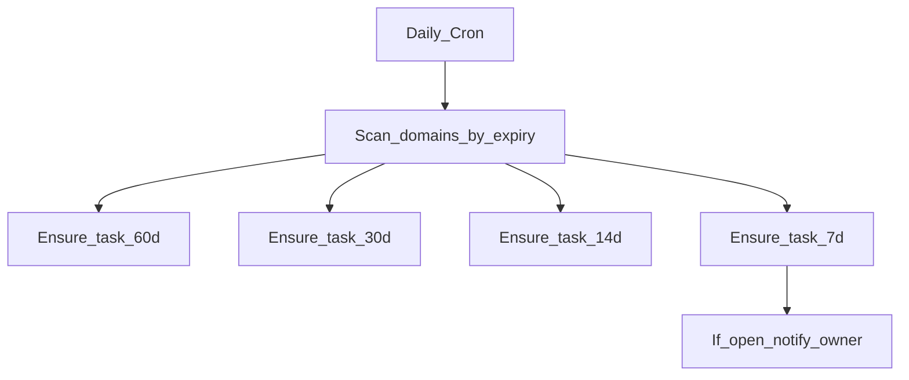

# Automation Workflows

All automation is Cloudflare-native (Cron, Queues, Workflows). **No n8n.**

## Principles

- Idempotent consumers (dedupe keys).
- Retries with backoff; dead-letter queue; admin replay.
- Manual recovery procedures documented per workflow.
- Measurable external API calls (`api_usage_ledger` for DataForSEO; domain checks counted).

## Workflow catalogue

| Workflow | Trigger | Actions |
| --- | --- | --- |
| Account provision | Stripe Checkout/webhook | Create org links, entitlements, welcome notification, admin new-customer alert |
| Stripe sync | Webhooks | Update subscription/items/entitlements idempotently |
| Onboarding reminder | Cron daily | Email/in-app if incomplete > N days |
| Domain availability assist | Customer action | Call search/check API only; store snapshot |
| Domain purchase task | Request + payment | Create admin task — **no buy API** |
| Domain renewal reminders | Cron daily | Tasks at 60/30/14/7 days; escalate |
| Email provision | Admin/auto when DNS ready | MXroute domain+mailbox; verify DNS auth records |
| Website project create | Onboarding complete / admin | Create website row + build task |
| Website deploy | Admin/CI action | Preview/live deploy hooks |
| GBP invite claimed | Customer “I’ve sent the invitation” | Notify admins/VA; create `gbp_accept_invite` task; status Invitation Sent (not Connected) |
| GBP help / no profile | Customer choice | Notify admins; create assist task; keep Action Required |
| Weekly GBP posts | Cron weekly | Create `gbp_post` VA tasks only for orgs with `gbp` entitlement **and** status Connected |
| GBP review replies | VA intake / Cron placeholder | `gbp_review_reply` tasks; manual completion + evidence |
| Overdue VA notify | Cron daily | Notify assignees/managers |
| Weekly rank checks | Cron weekly | **Only if** entitlement + project enabled + system live |
| Subscription status changes | Webhooks | Pause/resume jobs; cancel-before-complete website flag |
| Customer notifications | Various | Fan-out to email/in-app |

## Explicitly excluded automations

- Automatic domain registration
- Automatic domain renewal payment at registrar
- Automatic domain delete/release/transfer on cancel
- Automatic GBP review scraping via unofficial means
- Marking GBP Connected from customer self-confirmation alone
- Rank-tracking purchases while feature flag false

## Domain renewal safeguard flow

## Dead-letter & recovery

- Failed queue messages → `dlq_*` with error; admin UI “Retry”.
- Stripe: replay from Dashboard or re-fetch event by id.
- MXroute: manual mailbox create + mark synced.
- Rank jobs: mark failed; do not infinite retry paid API without budget check.
