# Customer Journey

## Marketing message (locked)

**£39.99/month for design, hosting and renewals handled. No minimum contract. Cancel anytime.**

Optional: **+ £9.99/month Google Rank Tracking** (only when feature flag enabled).

Never claim the managed service is free. Disclose ownership, transfer, and cancellation limitations clearly.

## Happy path

```mermaid
flowchart LR
  Visit[Visit_sales_site] --> Choose[Select_39.99]
  Choose --> Upsell[Optional_9.99_if_enabled]
  Upsell --> Terms[Review_terms_totals]
  Terms --> Pay[Stripe_Checkout]
  Pay --> Wh[Webhook_provision]
  Wh --> Onboard[Onboarding]
  Onboard --> Build[Website_production]
  Build --> Live[Go_live]
  Live --> Manage[Dashboard_use]
```

### Steps

1. Discover via homepage / industry landing (plumbers, electricians, roofers, cleaners, fencing, etc.).
2. Read Pricing, How It Works, Examples, FAQ.
3. Start Signup → authenticate.
4. Select £39.99 package; optionally tick rank tracking **only if** `rank_tracking_checkout_enabled`.
5. Review totals (£39.99 or £49.98), cancel-anytime terms, ownership summary.
6. Stripe Checkout (server Price IDs).
7. Webhook confirms payment → organisation `active`, entitlements granted, admin “new customer” notification.
8. Guided onboarding (save/resume).
9. Admin domain purchase (if new domain) after payment + request.
10. Website production → preview → customer approval → live.
11. Ongoing: hosting, email, weekly GBP tasks, support.

## Checkout totals

| Selection | Monthly |
| --- | --- |
| Website only | £39.99 |
| Website + tracking (when offered) | £49.98 |

## Cancellation journey (anytime)

1. Customer opens Billing → Cancel subscription.
2. UI shows **effective end date** = `current_period_end`.
3. Confirm: services continue until that date; no partial-month auto-refund (statutory rights preserved in copy).
4. Stripe `cancel_at_period_end=true`.
5. Org status → `cancelling` then `cancelled` at period end.
6. Offboarding checklist presented:
   - Domain renewal & transfer arrangements
   - Business email access & migration
   - Website hosting end date & transfer options (**transfer policy OPEN — legal**)
7. At period end: stop GBP tasks; revoke hosting entitlement; stop rank jobs if any; **retain** data per retention policy (no auto-delete of domain/email/site/files).

### Cancel add-on only

- Remove rank-tracking subscription item; entitlement ends at item period end.
- Core website subscription unaffected.

## Cancellation before website is completed

**Confirmed product handling:**

| Situation | Behaviour |
| --- | --- |
| Customer cancels while website status is `not_started` / `in_progress` / `preview_ready` / `awaiting_approval` | Mark website `cancelled_before_complete`; pause further build work after confirmation (or immediately stop new billable production effort — ops default: **stop new creative work on cancel request**, finish only critical handoff notes). |
| Paid period remaining | Customer retains dashboard access until period end; may download/export their uploaded content and onboarding data. |
| Domain request `awaiting_purchase` | Admin **must not** purchase the domain after cancel is confirmed, unless already purchased. Close purchase task as cancelled. |
| Domain already purchased | Domain remains; proceed with normal domain retain/transfer messaging. Never auto-release. |
| Email not yet provisioned | Do not provision after cancel confirmation. |
| Refund of current period | **Default: no automatic refund.** Any goodwill/statutory refund is manual via Stripe and logged. **Legal review required** for consumer vs B2B. |
| Reactivation before period end | Allow resume of subscription cancel flag; website returns to queue with priority note. |
| Reactivation after period end | New Checkout; new website project may be required if archived. |

Admin dashboard must surface “cancelled during build” for capacity planning.

## Reactivation

- If `cancel_at_period_end` still within period: clear cancel flag.
- If fully cancelled: new Checkout Session; restore entitlements on payment.

## Industry landing pages

Dedicated SEO landers for trades with same CTA into Signup/Checkout. Content templates share design system; unique copy per trade.

## Required sales pages

Homepage, Pricing, How It Works, Website Examples, FAQ, Contact, Login, Signup, Terms, Privacy, Cookie Policy, plus trade landers.

## Related

- [STRIPE_BILLING.md](./STRIPE_BILLING.md)
- [ONBOARDING_FLOW.md](./ONBOARDING_FLOW.md)
- [WEBSITE_PROVISIONING.md](./WEBSITE_PROVISIONING.md)
- [OPEN_QUESTIONS.md](./OPEN_QUESTIONS.md)
