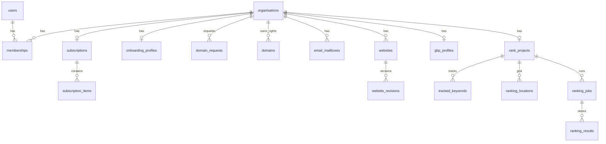

# Database Schema (Cloudflare D1 + Drizzle)

## Conventions

- Primary keys: `text` ULIDs / UUIDv7 strings.
- Timestamps: ISO-8601 text or integer unix ms — pick one project-wide (`created_at`, `updated_at`).
- Soft deletes where retention requires (`deleted_at`) rather than hard delete for customer content.
- Every customer-owned row includes `organisation_id` (except global tables: users, roles, templates, audit may reference actor).
- Indexes on foreign keys and high-cardinality filters (`status`, `stripe_customer_id`, `domain_name`).
- Uniqueness: Stripe IDs, domain names (active), membership (org+user), keywords per project.

## Entity relationship (core)

## Tables

### Identity & RBAC

**users**  
`id`, `email` (unique), `name`, `phone`, `email_verified_at`, `mfa_enabled`, Better Auth-linked fields as required, `created_at`, `updated_at`

**organisations**  
`id`, `trading_name`, `registered_company_name`, `companies_house_number`, `status` (`prospect`|`active`|`cancelling`|`cancelled`|`churned`), `stripe_customer_id` (unique), `created_at`, `updated_at`

**memberships**  
`id`, `organisation_id`, `user_id`, `role` (`platform_owner`|`administrator`|`website_developer`|`gbp_manager`|`support_agent`|`customer`), unique(`organisation_id`,`user_id`)

Staff may have memberships without a customer org, or a separate `staff_roles` table — prefer `memberships` with `organisation_id` nullable for global staff **or** `staff_assignments` for platform-wide roles. Recommendation: **`platform_roles`** table for staff (`user_id`, `role`) plus customer `memberships`.

**platform_roles**  
`id`, `user_id`, `role`, unique(`user_id`,`role`)

### Billing

**subscriptions**  
`id`, `organisation_id` (unique active), `stripe_subscription_id` (unique), `status`, `cancel_at_period_end` (bool), `current_period_start`, `current_period_end`, `canceled_at`, `created_at`, `updated_at`  
**No** `minimum_term_*` fields.

**subscription_items**  
`id`, `subscription_id`, `stripe_subscription_item_id`, `price_key` (`website_monthly`|`rank_tracking_monthly`), `stripe_price_id`, `status`, `created_at`

**entitlements**  
`id`, `organisation_id`, `key` (`website_hosting`|`email`|`gbp`|`rank_tracking`|`domain_renewal_cover`), `active` (bool), `valid_until`, `source` (`stripe`|`manual_grant`), unique(`organisation_id`,`key`)

**stripe_events**  
`id`, `stripe_event_id` (unique), `type`, `processed_at`, `payload_hash`, `status` (`processed`|`failed`), `error`

**invoices_cache** (optional mirror)  
`id`, `organisation_id`, `stripe_invoice_id`, `amount_due`, `currency`, `status`, `hosted_invoice_url`, `created_at`

### Onboarding & business profile

**onboarding_profiles**  
`id`, `organisation_id` (unique), `current_step`, `completed_at`, `data_json` (structured sections), `updated_at`

**business_profiles**  
Normalised extract from onboarding: address, service areas, description, socials, preferences, forms flags, WhatsApp, etc.

**uploads**  
`id`, `organisation_id`, `r2_key`, `filename`, `content_type`, `size_bytes`, `category` (`logo`|`photo`|`video`|`other`), `created_by`, `created_at`

### Domains (manual purchase)

**domain_requests**  
`id`, `organisation_id`, `domain_name`, `tld` (`com`|`co.uk`), `mode` (`new`|`existing`),  
`check_status`, `registrable`, `tier` (`standard`|`premium`), `quoted_registration_cost`, `quoted_renewal_cost`, `currency`,  
`customer_acknowledged_no_guarantee` (bool), `preferred_at`,  
`registrant_json` (customer legal registrant details),  
`status` (`requested`|`awaiting_purchase`|`purchased`|`unavailable`|`customer_action_required`|`registration_failed`|`cancelled`),  
`created_at`, `updated_at`  
Unique partial: one active request per org where practical.

**domains**  
`id`, `organisation_id`, `domain_name` (unique), `mode` (`new`|`existing`),  
`registrar`, `registrar_account_ref`,  
`registrant_name`, `registrant_organisation`, `registrant_email`, `registrant_json`,  
`registration_date`, `expiry_date`, `renewal_cost`, `renewal_currency`,  
`dns_provider`, `dns_status`,  
`registration_status` (`requested`|`awaiting_purchase`|`purchased`|`dns_setup`|`connected`|`active`|`unavailable`|`customer_action_required`|`registration_failed`|`renewal_due`|`transfer_pending`),  
`renewal_status`, `transfer_status`,  
`ownership_notes`, `created_at`, `updated_at`

**domain_orders**  
Audit of purchase attempts/records: `id`, `domain_id`, `organisation_id`, `type` (`register`|`renew`|`transfer`), `trigger` (`admin_manual`), `payment_gate_passed`, `recheck_json`, `admin_user_id`, `external_order_ref`, `cost`, `status`, `idempotency_key` (unique), `created_at`

**dns_checks**  
`id`, `domain_id`, `record_type`, `expected`, `observed`, `ok`, `checked_at`

**domain_renewal_tasks**  
Generated by Cron: `id`, `domain_id`, `organisation_id`, `due_window` (`60`|`30`|`14`|`7`), `status`, `assignee_id`, `completed_at`

### Email

**email_mailboxes**  
`id`, `organisation_id`, `domain_id`, `local_part`, `full_address`, `quota_mb`, `mxroute_status`, `webmail_url`, `mx_overwrite_approved` (bool), `spf_ok`, `dkim_ok`, `dmarc_ok`, `created_at`

### Websites

**templates**  
`id`, `slug`, `industry`, `name`, `version`, `repo_path`, `preview_image_key`, `active`

**websites**  
`id`, `organisation_id`, `template_id`, `status` (`not_started`|`in_progress`|`preview_ready`|`awaiting_approval`|`live`|`paused`|`cancelled_before_complete`|`archived`),  
`preview_url`, `live_url`, `custom_hostname`, `content_json` ref or blob id, `customer_approved_at`, `cancelled_during_build` (bool), `created_at`, `updated_at`

**website_revisions**  
`id`, `website_id`, `revision`, `content_snapshot`, `created_by`, `created_at`, `note`

### Google Business Profile (manual)

**gbp_profiles**  
`id`, `organisation_id`, `profile_url`,  
`access_status` (`action_required`|`invitation_sent`|`connected`|`help_requested`|`no_profile`|`blocked`),  
`manager_email_shown`, `invitation_claimed_at`, `invitation_claimed_by_user_id`,  
`verified_at`, `verified_by_user_id`, `verification_note`, `verification_evidence_r2_key`,  
`approval_preferences_json`, `notes`, `created_at`, `updated_at`  
Customer labels: Action Required / Invitation Sent / Connected (see GOOGLE_BUSINESS_MANAGEMENT.md).  
**Connected requires staff verification fields populated — never set from customer click alone.**

**gbp_posts** / **gbp_review_replies**  
Manual completion records: draft, approval status, publishing status, published_at, evidence URL and/or R2 screenshot, assignee, activity history rows (or linked `task_activity` table).

**tasks**  
Polymorphic work queue: `id`, `organisation_id`, `type` (`gbp_post`|`gbp_review_reply`|`gbp_accept_invite`|`gbp_assist_setup`|`domain_purchase`|`domain_renewal`|`website_build`|`email_provision`|`support`), `status`, `due_at`, `assignee_id`, `payload_json`, `completed_at`

### Rank tracking (gated)

**rank_projects**  
`id`, `organisation_id`, `enabled`, `center_lat`, `center_lng`, `grid_spacing_meters`, `zoom`, `language_code`, `se_domain`, `device`, `place_id` / maps identifiers

**tracked_keywords**  
`id`, `project_id`, `keyword`, max 5 enforced in app, unique(`project_id`,`keyword`)

**ranking_locations**  
9 fixed grid points: `id`, `project_id`, `label`, `lat`, `lng`, `position_index` 0–8

**ranking_jobs** / **ranking_results** / **api_usage_ledger**  
Job batching, organic vs maps distinction, cost cents, org caps.

### Support & ops

**support_tickets**, **ticket_messages**  
**notifications**  
**audit_logs** — `actor_user_id`, `organisation_id`, `action`, `entity_type`, `entity_id`, `diff_json`, `ip`, `created_at`  
**feature_flags** — `key`, `enabled`, `updated_at` (e.g. `rank_tracking_checkout_enabled`)

## Tenant isolation rules

1. Customer role: only rows for their `organisation_id`.
2. Staff: require `platform_roles`; still log access.
3. Signed URLs scoped to org-owned R2 keys.
4. Stripe customer IDs never trusted from client without server session match.

## Retention (draft — legal review)

| Data | Retention |
| --- | --- |
| Active customer data | Life of account + subscription |
| Cancelled org content | Retain per offboarding policy (default 90 days post final period end unless transfer/export requested) — **OPEN** |
| Audit logs | ≥ 18 months |
| Stripe events | ≥ 24 months |
| Rank results | While add-on active + 12 months after |
| Backups | D1 export schedule daily staging/prod |

## Migrations

- Drizzle migrations applied via Wrangler D1 for each environment.
- Never destructive production migrations without approval.
