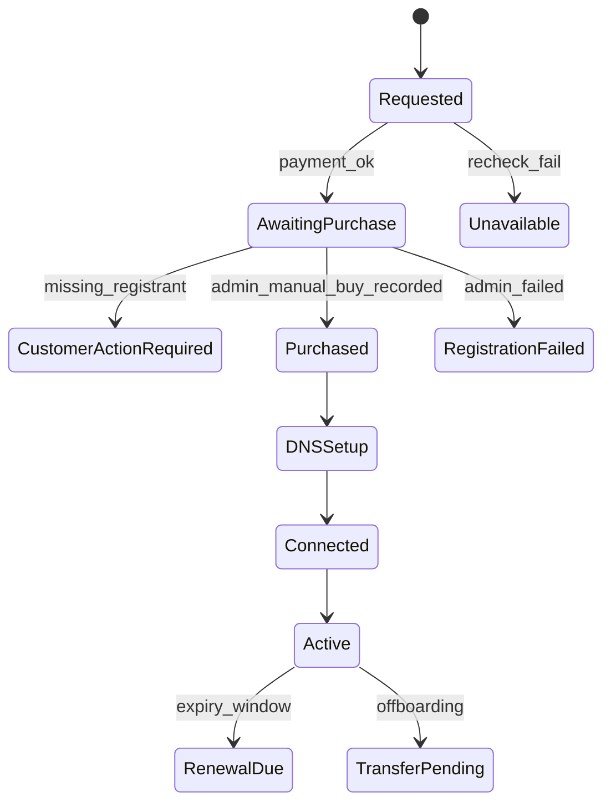

# Domain Management

## Locked rules

| Capability | Allowed? |
| --- | --- |
| Domain search API | Yes |
| Availability check API | Yes |
| Price check API | Yes |
| Automatic purchase | **No** |
| Automatic registration | **No** |
| Automatic renewal | **No** |
| Manual admin registration | **Required** |
| Manual admin renewal | **Required** |
| Audit logs | **Required** |

Supported extensions: **`.com`**, **`.co.uk`** only. Exclude premium. Proposed ceilings: **£15** registration / **£15** renewal per year (admin-configurable).

**Purchase gate:** Domain is purchased only after the customer’s subscription payment has succeeded. Nothing is bought at the registrar before we are paid.

## Registrant & ownership

- Capture full **customer registrant details** during onboarding.
- When purchasing manually, admins must use **customer/business registrant details wherever the registrar UI/API supports it**.
- Disclose in Terms: customer ownership rights in the domain; company may hold the registrar login/management until transfer; transfer process on cancel.
- Exact WHOIS display name vs account holder nuances → **legal review** ([OPEN_QUESTIONS.md](./OPEN_QUESTIONS.md)).

## Provider choice for checks

**Preferred:** Cloudflare Registrar API beta — `domain-search` and `domain-check` (verify `.com` / `.co.uk` against the account in staging; treat `extension_not_supported_via_api` / premium / over-ceiling as blocked).

**Important:** Even if Cloudflare Registrar supports programmatic **registration**, this product **must not** call registration or renewal endpoints. Admin buys in the registrar dashboard (Cloudflare or alternate).

If check API is unavailable for an extension, show “manual check required” and create support task — do not invent availability.

## Customer UX

1. Enter name → check `.com` / `.co.uk`.
2. Show availability + standard price or reject premium/expensive.
3. Acknowledge non-guarantee disclaimer.
4. Submit preferred domain → `Requested`.

## Admin purchase workflow

### Checklist before admin clicks buy

1. Subscription payment succeeded / entitlement active.
2. Org not cancelled (or cancel not confirmed blocking purchase).
3. Recheck availability + price ≤ ceiling.
4. Confirm registrant JSON complete.
5. Customer still wants this domain (no superseding request).
6. Purchase manually at registrar.
7. Record: registrar, order ref, registration date, expiry, renewal cost, DNS provider, registration status `Purchased`.
8. Write `domain_orders` + `audit_logs`.
9. Spawn DNS setup task.

### Operational safeguards (manual purchase)

| Risk | Safeguard |
| --- | --- |
| Domain sniped after select | Disclaimer; SLA target (e.g. purchase within 1 business day); recheck immediately before buy; notify customer if unavailable and offer alternatives |
| Double purchase | Idempotency key on `domain_orders`; UI disables buy if already `Purchased` |
| Buy after cancel | Task list filters require active entitlement; hard block in admin action API |
| Overpaying premium | Recheck tier/price; block if premium or > ceiling |
| Missing registrant | Status `Customer Action Required`; cannot mark Purchased |
| Registrar account limits | Dashboard metric for domains under management; alert before Cloudflare 500-domain account cap if using CF registrar |
| Audit gaps | Every status change logged with admin user id |

## Existing domains

- Mode `existing`: customer keeps registrar.
- Provide DNS records for website (+ email if migrating).
- Assisted setup ticket; Namecheap delegated access where appropriate.
- Preserve email DNS unless `mx_overwrite_approved`.

## Renewals (manual)

Cron generates admin tasks at **60, 30, 14, and 7 days** before `expiry_date`:

- Only for domains we manage renewals for.
- Standard renewal included while subscription has `domain_renewal_cover` entitlement.
- Escalation: 7-day task unread → notify Platform Owner.
- Dashboard “Renewal Due” queue sorted by expiry.
- Failed renewal → status + customer notification draft for admin send.
- **Never** auto-charge registrar; **never** auto-delete/release/transfer on subscription cancel.

## Cancelled customers

- Provide instructions to retain/renew/transfer.
- Transfer status `Transfer Pending` when process starts.
- Manual transfer only.

## DNS connection

After purchase: create zone or DNS records as applicable; verify SSL when site attached; track `dns_checks`.
