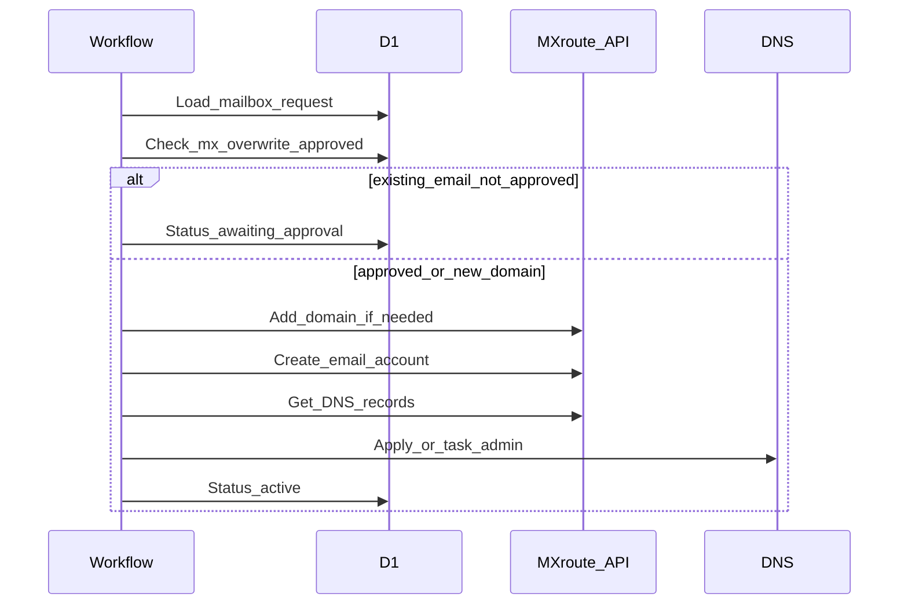

# Email Management (MXroute)

## Context

Existing MXroute account: Small hosting package, 10 GB total storage, unlimited domains/mailboxes (subject to storage), API key management. May upgrade to reseller later.

Each customer receives **one** custom mailbox. Proposed quota: **1024 MB** (1 GB) per mailbox, subject to total capacity.

## Verified API capabilities (api.mxroute.com)

Documented operations include:

- Domains: add/remove/configure; DNS verification
- Email accounts: create/update/delete; quota; send limits
- Forwarders, spam settings, catch-all
- DNS information: MX, SPF, DKIM, verification records
- Quota usage monitoring
- Reseller user/package management (reseller accounts)

Auth headers (Worker secrets only): `X-Server`, `X-Username`, `X-API-Key`.

Rate limits (per current docs): treat conservatively in queue workers; respect `X-RateLimit-*` headers. (Docs have listed read/write limits; implement adaptive backoff.)

## Provisioning workflow

1. Trigger after domain DNS ownership path is clear (new domain purchased **or** existing domain authorised).
2. Create mailbox with quota 1024 MB.
3. Store provisioning status for customer/admin dashboards.
4. Show webmail URL/instructions (MXroute webmail hostname from ops config).
5. Never expose API credentials to the frontend.

## DNS / authentication

- Configure SPF, DKIM, DMARC using records returned by MXroute DNS endpoints where available.
- Verify and store `spf_ok`, `dkim_ok`, `dmarc_ok`.
- **Never** overwrite existing MX/SPF/DKIM/DMARC without checking current config and `mx_overwrite_approved`.

## Capacity safeguards

- Track aggregate mailbox quotas vs 10 GB plan.
- Alert at 70% / 85% storage.
- Pause new mailbox provisioning when capacity insufficient; admin upgrade path to larger/reseller package.
- Design integration client so switching to reseller impersonation (`reseller|user`) is configuration-only.

## Offboarding

- On cancel: access continues to period end; then suspend send or disable login per policy — **do not auto-delete** mailbox immediately.
- Provide migration instructions (export via IMAP).
- Deletion only after retention window + explicit admin action (audited).

## Future

Schema and client should tolerate per-customer DirectAdmin users under reseller without rewriting callers.
