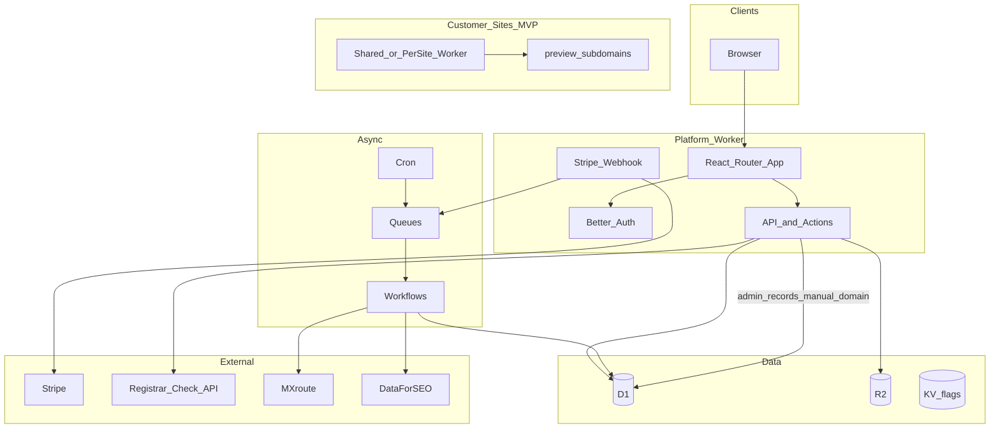
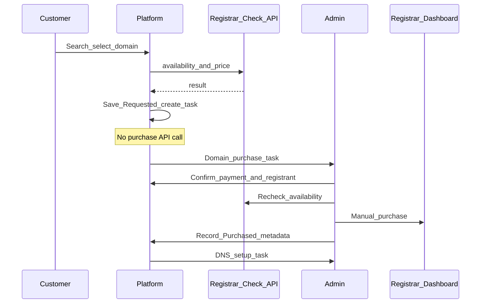

# System Architecture

## Overview

A modular monorepo hosts:

1. **Platform app** — sales site, auth, customer dashboard, admin/VA dashboard, APIs, Stripe webhooks.
2. **Jobs workers** — Cron, Queue consumers, durable Workflows for email provisioning, ranking (when enabled), notifications, domain reminder tasks.
3. **Customer websites** — template-driven sites with content separated from template source; MVP hosting on platform-controlled subdomains; custom hostnames escalated carefully (see below).

## Environments

| Environment | Purpose |
| --- | --- |
| `development` | Local Wrangler / Vite; local D1; Stripe test mode |
| `staging` | Shared Cloudflare staging resources; Stripe test; synthetic customers |
| `production` | Live; separate D1/R2/Queues/secrets/Stripe live keys |

Never share D1 databases or Stripe webhook secrets across environments.

## Tenancy model

- Root tenant: `organisations` (one per customer business).
- Users join via `memberships` with roles.
- Every business query is scoped by `organisation_id`.
- Staff roles operate across orgs with server-side RBAC and audit logs.

## Major subsystems

| Subsystem | Responsibility |
| --- | --- |
| Sales & Checkout | Marketing pages, Stripe Checkout Session creation |
| Auth | Better Auth sessions; staff MFA |
| Onboarding | Multi-step wizard; R2 uploads; domain preference |
| Billing | Webhooks → entitlements in D1 |
| Domains | Search/check API; admin purchase queue; renewal tasks |
| Email | MXroute provisioning workflows |
| Websites | Template + content → preview/live |
| GBP | Weekly tasks; VA completion evidence |
| Rank tracking | Feature-flagged; DataForSEO jobs |
| Support | Tickets + notifications |

## Customer website hosting decision (MVP vs scale)

### MVP (locked for launch)

**Simpler Workers architecture — Cloudflare for SaaS not required for MVP.**

Rationale:

- At early volume, customer sites can be served as:
  - Preview: `https://{projectId}.preview.iwantfreewebsite.com` (or similar) via Workers routes / custom domains on our zone.
  - Live (domains we manage on Cloudflare DNS): point apex/www DNS on the Cloudflare zone we control to the site Worker.
- Templates are **our** code with per-customer content from D1/R2 — not untrusted customer code — so Workers for Platforms is unnecessary at MVP.
- Cloudflare for SaaS adds custom-hostname certificate automation for **customer-controlled DNS** pointing at our SaaS zone. That is valuable when many customers keep external registrars and CNAMEs to us, but it is an extra product/config surface.

**MVP path:**

1. Deploy template sites as Workers Static Assets (shared template Worker with org-resolved content, or one generated Worker per site if isolation is preferred operationally).
2. Use platform-owned preview hostnames.
3. For admin-purchased domains on Cloudflare DNS: configure DNS + Worker route/custom domain manually/scripted by admin tools — still no Cloudflare for SaaS requirement.

### Post-MVP

Introduce **Cloudflare for SaaS** when:

- Existing-domain customers commonly keep DNS elsewhere and need vanity hostnames with automated TLS, or
- Manual custom-domain certificate/DNS ops become a bottleneck.

Introduce **Workers for Platforms** only if/when each site needs strongly isolated deployable Worker scripts at large scale.

## Domain purchase boundary

## Security boundaries

- Secrets only in Worker secrets / Cloudflare dashboard (Stripe, MXroute, DataForSEO, registrar check token).
- Turnstile on public forms.
- Stripe webhook signature verification.
- R2 private; short-lived signed URLs.
- Rank-tracking Checkout gated by KV/D1 feature flag.

## Related documents

- [TECH_STACK.md](./TECH_STACK.md)
- [AUTOMATION_WORKFLOWS.md](./AUTOMATION_WORKFLOWS.md)
- [WEBSITE_PROVISIONING.md](./WEBSITE_PROVISIONING.md)
- [DOMAIN_MANAGEMENT.md](./DOMAIN_MANAGEMENT.md)
